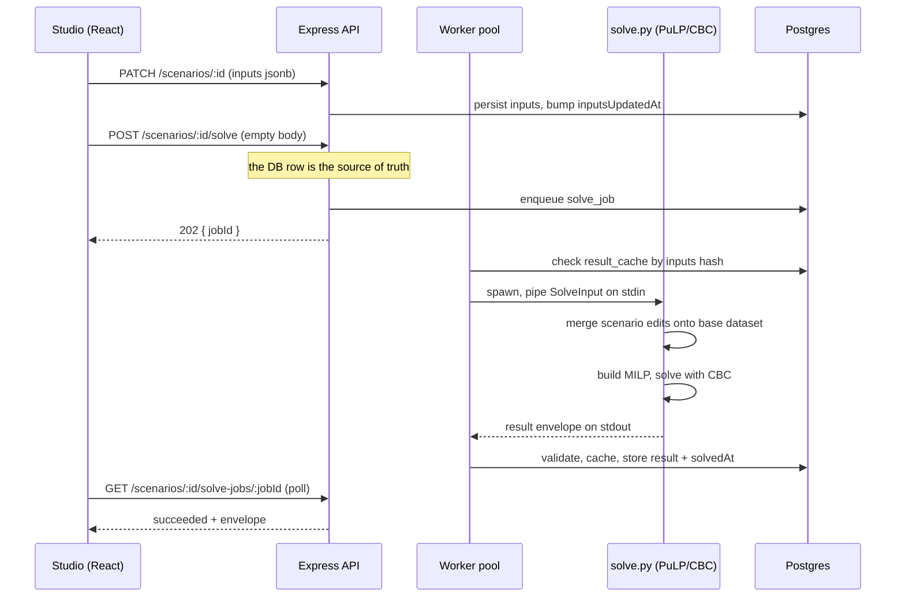
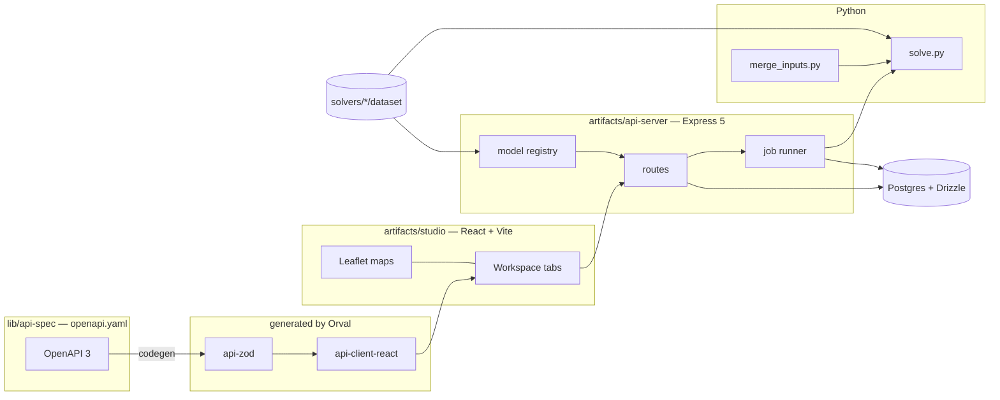

# Network Optimization Studio

**A browser-based supply-chain network design lab.** Students build a facility-location or flow scenario on a live map, hand it to a real MILP solver (PuLP/CBC), and read the optimum back as maps, grids, and cost reports — no notebooks, no Python install, no spreadsheets.

Six textbook models from Watson et al., *Supply Chain Network Design*, are implemented end-to-end and validated against the book's own published answers.

[](https://github.com/ShubhamKr07/network-optimization-studio/actions/workflows/ci.yml)

🔗 **Live:** [[https://app.networkdesignbook.com](https://app.networkdesignbook.com)] · API: [`/api/models`](https://nos-api-uwf8.onrender.com/api/models) (Render free tier — first request wakes the service, give it ~30s)

---

## What it does

You pick a chapter, get a real dataset on a real map, and start making decisions:

- **Choose how many facilities to open** (`p`), force specific sites open, deactivate others, cap capacity uniformly or per-site.
- **Edit the network itself** — click the map to add a warehouse, mine, refinery, plant, or customer that isn't in the textbook; drag it to move it; override an individual lane's distance or cost.
- **Solve for real.** The scenario is sent to CBC through PuLP. No heuristics, no precomputed answers — an infeasible scenario comes back infeasible, with a reason.
- **Read the result** as a colored network map, per-band service coverage, open-facility and assignment grids, flow tables, and a cost summary — then compare scenarios side by side.

Everything a student changes is scoped to *their* scenario. The base textbook datasets on disk are never mutated.

## Model catalogue

| Model | Book | Decision | Dataset | Solver |
|---|---|---|---|---|
| **Al's Athletics** `p-median-us` | Ch. 3 | Which *p* of 26 US warehouses to open | 26 WH · 200 customers · 5,200 distances | `solve_pmedian` |
| **Al's Athletics — Max Coverage** `max-coverage-us` | Ch. 4 | Service-level siting in the US — maximize covered demand *or* minimize demand-distance | 26 WH · 200 customers · 5,200 distances (km) | `solve_max_coverage` |
| **Coal Transport LP** `transport-coal` | Ch. 5 | Mine → power-station flow assignment | 4 mines · 15 stations · 60 lanes | `solve_transport` |
| **Brazil Capacity** `p-median-brazil` | Ch. 5 | Capacitated p-median over 25 Brazilian states | 25 sites · 625 distances | `solve_capacitated_pmedian` |
| **JADE Investment** `two-echelon-jade-us` | Ch. 9 | Multi-product plant→warehouse→customer network with plant/product capability | 4 plants · 4 products · 25 WH · 100 customers | `solve_jade` |
| **Gold Refinery Siting** `two-echelon-gold-au` | Ch. 10 | Mine → refinery → customer, with a bill-of-materials ratio across legs | 1 mine · 2 refineries · 10 customers | `solve_two_echelon` |

Each model is a self-describing package on disk:

```
solvers/<model-id>/
  manifest.json      id, chapter, map bounds, capability flags, inputs schema
  dataset/*.json     the textbook data + a version.json carrying a sha256
  tests/             model-specific pytest goldens
```

Drop a new directory in, and the model registry picks it up at boot — `GET /api/models` lists it, the frontend routes to it, the UI gates features off its `capabilities` block. No hardcoded model list anywhere.

## Feature tour

**Tabbed workspace.** Each scenario opens as a tree of tabs — Input Map, per-entity grids (Warehouses / Customers / Mines / Stations / Plants / Distances / Lane Costs / Capability Matrix), Optimization Parameters, then output tabs once solved. Manual save only: nothing is written until you press Save, so a half-finished edit never silently persists.

**Map-first editing.** Click an empty spot on the input map → confirm a draft marker → the entity form opens pre-filled with the clicked coordinates. Left-click an existing entity for details, right-click for move/copy/delete. Added entities get their distances estimated automatically (haversine × a per-model circuity factor) so the solver has a complete matrix.

**Bulk edit via CSV/JSON.** Export any entity table, edit it in a spreadsheet, re-import. The importer classifies every problem as `format` / `syntax` / `logic`, previews the exact changed rows before applying, and offers all-or-nothing or partial modes. Bad rows are skipped, never fatal.

**Asynchronous solving.** `POST /scenarios/:id/solve` enqueues a job (`202 {jobId}`) and returns immediately; an in-process worker pool with configurable concurrency and queue-depth backpressure (`429` + `Retry-After`) runs CBC out of process. The UI polls, shows a live elapsed clock, and never blocks the event loop.

**Content-addressed result cache.** Inputs are hashed; an identical scenario returns a cached envelope without spawning the solver at all.

**Staleness guard.** `Scenario.stale` is derived, never stored (`result != null && inputsUpdatedAt > solvedAt`). Edit an input after solving and the old result stays visible — clearly badged "Stale · re-solve" rather than silently passing itself off as current.

**Pre-solve checks.** A semantic precheck catches zero-demand networks, unreachable customers, and infeasible coverage floors *before* burning a solve.

**Distance bands as a lens, not a constraint.** Bands are computed in post-processing, so re-banding a solved result recolors the map and recomputes coverage instantly, client-side, with zero network calls and no re-solve.

**Reporting.** Open-facility and assignment grids, per-leg average distances, flow tables, plant production rollups, utilization, cost summary with side-by-side scenario compare, a session-local result-history stepper (back/forward through your own solves, inputs restored with each), and one-click "Copy map to clipboard".

## How a solve actually runs



Every model returns the same envelope — `{status, objective, runTimeSec, quality, edges, metrics, details, solverUsed, infeasibilityReason}` — so the entire frontend renders six different optimization problems through one contract.

The wrapper **never throws**: a crash, timeout, or unparseable stdout all degrade to a well-formed `{status: "error", infeasibilityReason}`.

## Architecture



**Contract-first.** `lib/api-spec/openapi.yaml` is the single source of truth. Orval generates the Zod validators and the React Query client from it; generated code is never hand-edited, and a spec change ships in the same commit as its regenerated output.

**Schema-light persistence.** A scenario is `{id, userId, name, modelId, inputs jsonb, result jsonb, ...}`. Model-specific shapes live in per-model Zod schemas selected by `modelId`, not in typed columns — adding a model touches zero DDL.

```
lib/api-spec/          OpenAPI contract + Orval config
lib/api-zod/           GENERATED Zod schemas
lib/api-client-react/  GENERATED React Query hooks
lib/db/                Drizzle schema (Postgres)
lib/dataset-schema/    manifest + dataset validation, version hashing
artifacts/api-server/  Express 5 API, model registry, job runner, Python solver
artifacts/studio/      React + Vite + Tailwind + Radix + Leaflet + TanStack Query
solvers/               seven self-describing model packages
docs/                  design system, ops runbooks, specs, plans, metrics
```

~109k lines of hand-written TypeScript/Python (plus ~4.5k generated), 1,317 lines of solver.

---

## Credits

Datasets, models, and expected answers are derived from Watson, Lewis, Cacioppi & Jayaraman, *Supply Chain Network Design* (chapters 3, 4, 5, 9, 10) and the accompanying case notebooks. Built as a teaching tool for that material.

Solver: [PuLP](https://github.com/coin-or/pulp) + [CBC](https://github.com/coin-or/Cbc). Maps: [Leaflet](https://leafletjs.com/) over OpenStreetMap tiles.
